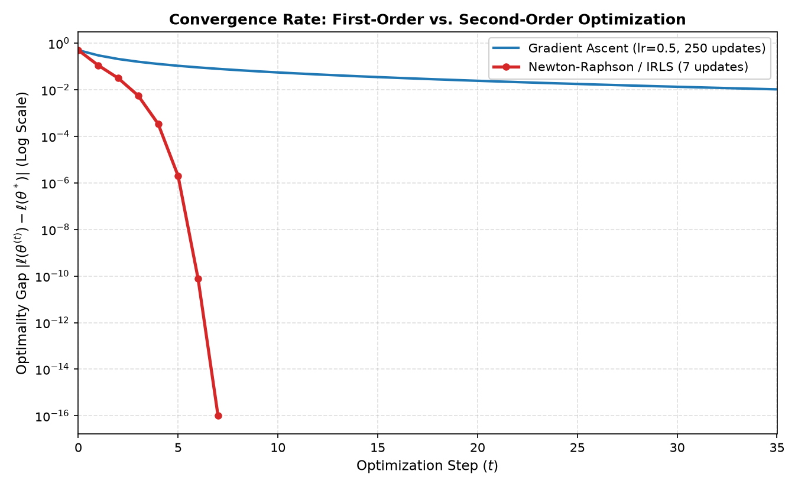
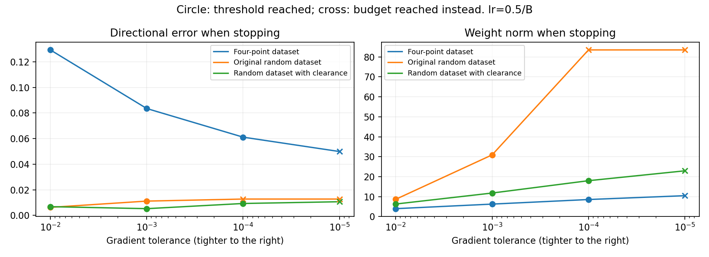

# Numerical Optimization & First-Principles Machine Learning

Independent implementations of ordinary least squares and binary logistic regression in NumPy, following the mathematical formulations studied in Stanford CS229. The project examines gradients, curvature, convergence experiments, and numerical limitations without using machine learning frameworks.

## Main investigation

**Does a small logistic gradient establish convergence when no finite minimizer exists?**
On the documented separable seed-42 dataset, tightening the gradient tolerance
from `1e-2` to `1e-3` requires 160 versus 5,505 updates but increases the distance
to the SVM direction from 0.00626 to 0.01115. Both thresholds are reached.
This is a finite-time counterexample to a better-direction interpretation of a
tighter gradient tolerance, not a contradiction of the published asymptotic result.

Read the [technical report](docs/separable-data.pdf), inspect the
[saved stopping results](results/separable/stopping_comparison.csv), or go to the
[reproduction commands](#reproduce-the-extension). The investigation builds on
the original solver comparison below; the directional convergence theorem is
attributed to Soudry et al. (2018).

## Run it

```bash
python -m venv .venv
source .venv/bin/activate  # Windows: .venv\Scripts\activate
python -m pip install -r requirements.txt
python benchmark.py
python -m experiments.study
python -m unittest discover -s tests -v
```

Run commands from the repository root. The study writes per-seed, accuracy-matched results to [`results/matched_accuracy.csv`](results/matched_accuracy.csv). The `test_*.py` files at the root are original demonstration scripts; `tests/test_numerics.py` contains the automated numerical checks.

---

## 1. Mathematical Formulations

### Ordinary Least Squares (OLS)

Given a design matrix $X \in \mathbb{R}^{n \times d}$ and target vector $y \in \mathbb{R}^n$, we augment $X$ with an intercept column to form $X_b = [\mathbf{1}, X] \in \mathbb{R}^{n \times (d+1)}$. The parameter vector is $\theta \in \mathbb{R}^{d+1}$.

#### Objective Function

The mean squared error (least mean squares) cost is defined as:

$$
J(\theta) = \frac{1}{2n} \lVert X_b\theta - y \rVert_2^2 = \frac{1}{2n} (X_b\theta - y)^T (X_b\theta - y)
$$

Expanding the quadratic form:

$$
J(\theta) = \frac{1}{2n} \left( \theta^T X_b^T X_b \theta - 2 y^T X_b \theta + y^T y \right)
$$

#### Analytical Solution (Normal Equations)

Taking the matrix derivative with respect to $\theta$:

$$
\nabla_\theta J(\theta) = \frac{1}{n} X_b^T (X_b\theta - y)
$$

Setting $\nabla_\theta J(\theta) = \mathbf{0}$ yields the normal equations:

$$
X_b^T X_b \theta = X_b^T y \implies \theta^{\star} = (X_b^T X_b)^{-1} X_b^T y
$$

> **Implementation note:** Rather than computing the explicit matrix inverse $(X_b^T X_b)^{-1}$, parameters are computed via `np.linalg.solve(X_b.T @ X_b, X_b.T @ y)`, which avoids forming an explicit inverse. Normal equations still square the design matrix's condition number; this educational solver assumes full column rank and is not a substitute for a QR- or SVD-based least-squares solver on ill-conditioned data.

---

### Binary Logistic Regression

For binary classification targets $y^{(i)} \in \{0, 1\}$, the model parametrizes class probabilities via the sigmoid activation $\sigma(z) = \frac{1}{1 + e^{-z}}$:

$$
p^{(i)} = P(y^{(i)} = 1 \mid x^{(i)}; \theta) = \sigma\left((x_b^{(i)})^T \theta\right)
$$

#### Objective: Log-Likelihood Maximization

Under independent Bernoulli trials, the average log-likelihood is:

$$
\ell(\theta) = \frac{1}{n} \sum_{i=1}^n \left[ y^{(i)} \ln\left(p^{(i)}\right) + (1 - y^{(i)}) \ln\left(1 - p^{(i)}\right) \right]
$$

#### First-Order Gradient (Ascent Direction)

Using the identity $\sigma'(z) = \sigma(z)(1 - \sigma(z))$:

$$
\frac{\partial \ell(\theta)}{\partial \theta_j} = \frac{1}{n} \sum_{i=1}^n \left( y^{(i)} - p^{(i)} \right) (X_b)_{i, j}
$$

In vectorized form:

$$
\nabla_\theta \ell(\theta) = \frac{1}{n} X_b^T (y - p)
$$

Gradient ascent updates parameters along the positive slope:

$$
\theta^{(t+1)} = \theta^{(t)} + \alpha \nabla_\theta \ell(\theta^{(t)})
$$

#### Second-Order Curvature: Hessian Matrix

Differentiating the gradient $\nabla_\theta \ell(\theta)$ with respect to $\theta_k$:

$$
H_{jk} = \frac{\partial^2 \ell(\theta)}{\partial \theta_j \, \partial \theta_k} = -\frac{1}{n} \sum_{i=1}^n (X_b)_{i, j} \, p^{(i)}(1 - p^{(i)}) \, (X_b)_{i, k}
$$

Defining the diagonal weight matrix $W \in \mathbb{R}^{n \times n}$ with $W_{ii} = p^{(i)}(1 - p^{(i)})$, the full Hessian is:

$$
H = -\frac{1}{n} X_b^T W X_b
$$

Because $W_{ii} \ge 0$ for all $i$, $H$ is **negative semi-definite**, written $H \preceq 0$.

#### Newton-Raphson Parameter Update

Applying Newton's method to the stationarity condition $\nabla_\theta \ell(\theta) = \mathbf{0}$ gives:

$$
\theta^{(t+1)} = \theta^{(t)} - H^{-1} \nabla_\theta \ell(\theta^{(t)})
$$

---

## 2. Numerical safeguards

Translating these equations directly into floating-point code causes numerical problems. This implementation uses four safeguards:

1. **Stable sigmoid.** The exponential is evaluated only at nonpositive arguments, avoiding overflow without clipping logits:

```python
exp_neg_abs = np.exp(-np.abs(z))
p = np.where(z >= 0, 1.0 / (1.0 + exp_neg_abs),
             exp_neg_abs / (1.0 + exp_neg_abs))
```

2. **Log-likelihood from logits.** Fitting evaluates the Bernoulli log-likelihood with `np.logaddexp`, avoiding `log(0)` and an artificial probability-clipping floor:

```python
signed_z = np.where(y == 1.0, -z, z)
ell = -np.mean(np.logaddexp(0.0, signed_z))
```

3. **Hessian assembly without a dense weight matrix.** Forming $W = \mathrm{diag}(w)$ as an $n \times n$ matrix costs $O(n^2)$ memory, roughly 80 GB for $n = 100{,}000$. Broadcasting scales the rows directly instead:

```python
   w = (p * (1.0 - p)).reshape(n, 1)              # Shape (n, 1)
   H = -(1.0 / n) * (X_b.T @ (w * X_b))           # Shape (d+1, d+1)
```

4. **Tikhonov curvature damping.** When predictions saturate ($p_i \to 0$ or $1$), $w_i \to 0$ and $H$ becomes nearly singular. For positive $\epsilon_{\text{reg}}$, subtracting it times the identity makes $H$ negative definite in exact arithmetic. This does not by itself guarantee a well-conditioned solve or a successful full Newton step in floating point. The update then subtracts the damped Newton step:

```python
   H_reg = H - eps_reg * np.eye(d + 1)
   delta = np.linalg.solve(H_reg, grad)
   theta = theta - delta
```

   With the default $\epsilon_{\text{reg}} = 10^{-8}$, damping had no visible effect at the reported precision in the original cluster experiments (Section 5). At $\epsilon_{\text{reg}} = 10^{-4}$, it shrinks the parameter norm on separable data.

---

## 3. Asymptotic Complexity Analysis

| Algorithm | Order | Per-iteration time | Memory | Convergence rate |
| :--- | :--- | :--- | :--- | :--- |
| OLS (normal equations) | Analytical | O(nd^2 + d^3), single solve | O(nd + d^2) | Direct solve; subject to floating-point error |
| Gradient ascent | First-order | O(nd) | O(nd + d) | Linear under suitable local strong concavity and step size |
| Newton-Raphson / IRLS | Second-order | O(nd^2 + d^3) | O(nd + d^2) | Locally quadratic for undamped Newton under regularity assumptions |

Memory entries describe solver working storage in addition to the input data and stored histories. All three implementations allocate the augmented design matrix, which costs O(nd); gradient ascent also creates observation-sized vectors. The current Newton implementation materializes a weighted design matrix. Broadcasting avoids an n-by-n weight matrix, but Hessian multiplication still costs O(nd^2).

The following textbook rates require assumptions: a finite solution, sufficient curvature, and an appropriate step size or starting point. They are not unconditional guarantees for separable logistic data. A fixed positive damping value can change Newton's asymptotic rate.

Under the corresponding assumptions:

* **Gradient ascent (linear):** $\lVert \theta^{(t)} - \theta^{\star} \rVert \le c^t \, \lVert \theta^{(0)} - \theta^{\star} \rVert$, with $0 < c < 1$.
* **Newton-Raphson (quadratic):** $\lVert \theta^{(t+1)} - \theta^{\star} \rVert \le M \, \lVert \theta^{(t)} - \theta^{\star} \rVert^2$.

### Trade-off Regimes

* **$d \ll n$ (few features, many samples):** Newton-Raphson needs far fewer iterations: 7 for the benchmark, against hundreds for gradient ascent at the benchmark learning rate. Each Newton update costs more, because it solves a $(d+1) \times (d+1)$ system, but with few features that cost is small (Section 5).
* **$d \gg n$ (high-dimensional):** First-order methods are the practical choice. The cost of forming and factoring a dense $d \times d$ matrix can dominate; the practical threshold depends on hardware and structure.

---

## 4. Empirical Convergence Benchmark

The benchmark compares first-order gradient ascent with second-order Newton-Raphson on synthetic Gaussian clusters.

### Experimental Setup

* **Dataset:** Bivariate binary classification with $n = 300$ and $d = 2$. A bias term gives $d + 1 = 3$ parameters.
* **Clusters:** $n_0 = n_1 = 150$, $\mu_0 = (-1, -1)^T$, $\mu_1 = (+1, +1)^T$, $\Sigma = I_2$ (so $\sigma = 1.0$), seed 42.
* **First-order baseline:** Gradient ascent with learning rate $\alpha = 0.5$, run for a budget of 250 updates. The history includes the initial point and each post-update point. It stops early only if $\lVert \nabla_\theta \ell \rVert < 10^{-5}$, which does not happen in this run.
* **Second-order method:** Newton-Raphson / IRLS with Tikhonov damping $\epsilon_{\text{reg}} = 10^{-8}$. It stops when $\lVert \nabla_\theta \ell(\theta) \rVert < 10^{-8}$, which takes 7 updates in this run.
* **Reference optimum:** $\ell^{\star} \approx -0.190684$ is computed from a separate Newton run with tolerance $10^{-12}$ and at most 60 iterations, not from the benchmark's own final iterate.
* **Optimality gap:** $\left|\ell(\theta^{(t)}) - \ell^{\star}\right|$. For display, gaps are clipped to $10^{-16}$. This plotting floor is not a certified error bound. The reference is a numerical approximation using the same solver, not an independent mathematical certificate.



The horizontal axis is truncated at $t = 35$ to show the quadratic phase. Gradient ascent continues to $t = 250$.

### Interpretation

* **Gradient ascent (blue):** The observed gap reduction is consistent with a linear convergence regime. It reaches $1.04 \times 10^{-2}$ at $t = 35$, first drops below $10^{-3}$ at update 98 ($9.75 \times 10^{-4}$), and reaches approximately $1.3 \times 10^{-5}$ by update 250.
* **Newton-Raphson (red):** The observed decrease before the floating-point floor is consistent with a local quadratic convergence phase. This experiment does not establish the asymptotic convergence order of the damped implementation.

| Update | Gap |
| :--- | :--- |
| 0 (initial) | 5.02e-1 |
| 1 | 1.12e-1 |
| 2 | 3.15e-2 |
| 3 | 5.61e-3 |
| 4 | 3.44e-4 |
| 5 | 1.99e-6 |
| 6 | 7.77e-11 |
| 7 | 1e-16 (clipped at the floating-point floor) |

---

## 5. Additional Experiments

### 20 Seeds and Learning-Rate Sweep

`experiments/study.py` repeats the comparison on 20 synthetic datasets, generated with seeds 0 to 19 using the benchmark's clusters, with $n = 300$.

* **Newton-Raphson:** With the same gradient-norm tolerance of $10^{-8}$, it takes 7 to 8 updates on every dataset.
* **Gradient ascent at $\alpha = 0.5$:** Measured against the reference optimum, it first reaches a gap below $10^{-3}$ after 57 to 182 iterations, and it reached that gap on every dataset.
* **Learning-rate sweep:** Gradient ascent stops at the gradient-norm tolerance of $10^{-5}$ or the 2000-iteration cap. At $\alpha = 0.05$ and $\alpha = 0.1$, the median run hits the cap. The medians for $\alpha = 0.5, 1.0, 2.0, 4.0$ are 683, 339, 166, and 65 iterations.

These original counts use different stopping rules. At the **same reference objective gap below 10^-3**, the reproduced 20-seed study takes **4–5 Newton updates versus 57–182 gradient-ascent updates** (learning rate 0.5), reaching the threshold on all 20 datasets. These are small, two-feature synthetic problems; fewer updates do not establish a general runtime advantage.

### Wall-clock time

`python -m experiments.study` measures 50 repeated runs per method and prints the median and interquartile range on the current machine. Newton uses its gradient-norm stopping rule; gradient ascent uses a 250-update budget. These timings are **not accuracy-matched speedup measurements** and depend on the machine, NumPy/BLAS, and process conditions. Compare update counts at a common objective gap using the CSV above.

### Damping Check

Each run used exactly 10 Newton updates, with the gradient stopping rule disabled, so every damping value is compared at the same step.

| Data | $\epsilon_{\text{reg}}$ | Parameter norm | Log-likelihood |
| :--- | :--- | :--- | :--- |
| Overlapping benchmark data | 0 | 2.832 | -0.190684 |
| Overlapping benchmark data | $10^{-8}$ | 2.832 | -0.190684 |
| Overlapping benchmark data | $10^{-4}$ | 2.832 | -0.190684 |
| Separable data (centers at $\pm 3$) | 0 | 3.598 | -0.000044 |
| Separable data (centers at $\pm 3$) | $10^{-8}$ | 3.598 | -0.000044 |
| Separable data (centers at $\pm 3$) | $10^{-4}$ | 3.440 | -0.000056 |

On the overlapping data, damping has no effect at any of the three values. On separable data, $\epsilon_{\text{reg}} = 10^{-8}$ also has no effect, and $10^{-4}$ shrinks the parameter norm while lowering the log-likelihood slightly. This is a finite-iteration damping effect; the experiment does not demonstrate prevention of a singular solve. Curvature damping is not the same as adding an L2 penalty to the objective. Separable data has no finite maximum likelihood estimate, so these values describe the state after 10 updates, not a converged solution.

---

## 6. Repository Structure

```text
numerical-optimization-ml/
├── README.md
├── benchmark.py                  # Original convergence comparison
├── requirements.txt             # NumPy and Matplotlib
├── requirements-separable.txt   # Optional Gurobi dependency
├── docs/separable-data.pdf       # Questions, experiments and conclusions
├── experiments/
│   ├── study.py                  # Original solver comparisons
│   ├── separable.py              # 21-run suite and stopping thresholds
│   ├── separable_control.py      # Exact four-point control
│   ├── separable_diagnostics.py  # Support and gradient diagnostics
│   └── separable_extensions.py   # Fixed-step clearance and L2 comparison
├── optimization/
│   ├── base.py                   # Bias augmentation and line search
│   ├── linear_model.py           # OLS solvers
│   ├── logistic_model.py         # Gradient ascent and Newton
│   └── separable_logistic.py     # Homogeneous loss, diagnostics and QP
├── tests/                        # Automated numerical and stopping checks
├── results/                      # CSVs, datasets, diagnostics and settings
└── figures/                      # Original benchmark and separable study
```

---

## 7. Reproduction

Clone the repository and install the requirements:

```bash
git clone https://github.com/Mrad-MedAziz/numerical-optimization-ml.git
cd numerical-optimization-ml
pip install -r requirements.txt
```

Run the benchmark:

```bash
python benchmark.py
```

Run the 20-seed experiments, timing, and damping check:

```bash
python -m experiments.study
```

## Numerical checks and limitations

`python -m unittest discover -s tests -v` checks finite-difference gradients, independent gradient-ascent/Newton agreement, extreme logits, rank-deficient curvature, iteration caps, and final objective consistency. A constructed duplicate-feature test makes an undamped solve singular while positive damping allows a finite fit. It is separate from the original overlapping/separable-data experiment and does not establish that the earlier experiment required damping.

Histories now contain the initial objective and the objective after each update; `n_iter_` is the actual number of updates and `converged_` records whether the gradient tolerance was met. Earlier capped logs omitted the final post-update objective and therefore undercounted completed updates by one. OLS `cost` now corresponds to the returned parameters.

The logistic solver uses full Newton steps without a line search. Damping alone does not guarantee global convergence. Separable data can lack a finite maximum-likelihood solution, and a small gradient does not imply bounded parameters. Results here are learning experiments, not novel algorithms or production-readiness claims.


---

## 8. Separable Data: Loss, Parameter Growth, and Stopping Criteria

The original solver comparison prompted a follow-up question: does a small
logistic gradient establish convergence when the data admit no finite
maximum-likelihood estimate? This extension studies the unregularized,
homogeneous model (no intercept), using labels in {-1, +1} and mean negative
log-likelihood. This is gradient descent on the negative of the earlier
log-likelihood; the label and intercept conventions are made explicit.

The investigation follows several questions:

* Can loss improve while the parameter norm grows?
* How does the normalized direction compare with a hard-margin SVM reference?
* Do larger safe steps, greater clearance, or tighter stopping tolerances
  consistently improve finite-budget directional accuracy?
* Could support-vector selection be a numerical-tolerance artifact, and
  which observations drive a non-monotone update?

The [technical report](docs/separable-data.pdf) gives the mathematical setting,
21-run design, numerical checks, figures, follow-up diagnostics, fixed-step clearance and regularization comparisons, and limitations.
It is a guided reproduction of Soudry et al. (2018), not a novel convergence
result. The four-point control shows steady directional progress; some
random-data trajectories pass near the SVM direction and then move away
within the recorded budget. Neither observation proves an infinite-time limit.

At the same seed-42 dataset and learning rate 0.5/B, tightening the gradient
norm tolerance from 1e-2 to 1e-3 requires 160 versus 5,505 updates and returns
directional error 0.00626 versus 0.01115. Both tolerances were reached.
Requested tolerances 1e-4 and 1e-5 instead hit the 100,000-update budget;
they are not reported as tolerance-converged runs.



### Reproduce the extension

The QP reference uses Gurobi. Install the optional dependency with an
appropriate Gurobi license, then run from the repository root:

```bash
python -m pip install -r requirements-separable.txt
python -m experiments.separable_control
python -m experiments.separable_diagnostics
python -m experiments.separable
python -m experiments.separable_extensions
python -m unittest discover -s tests -v
```

`experiments.separable` saves CSVs, exact datasets, reference checks and
configuration under `results/separable/`, with figures under
`figures/separable/`. It checks seven datasets (a four-point control plus
three seeds for each random family), three step sizes and four stopping
tolerances. The control and exploratory diagnostic use step 0.1; the repeated
suite uses steps 0.1/B, 0.5/B and 1/B. The original overlapping-data solver
comparison remains available through `python -m experiments.study`.

A small gradient is a stopping measurement, not a certificate of a finite
minimizer or of directional accuracy. The new mathematical and experimental
arguments, limitations, sources and assistance statement are documented in
the study rather than presented as independent discoveries.


### Follow-up comparisons

`python -m experiments.separable_extensions` runs two additional comparisons:

* **Clearance at a shared absolute step:** each original/clearance pair uses
  `0.5 / max(B_original, B_clearance)` for both datasets, from zero, for 100,000
  updates. This removes the different-step-size confound within a pair; the
  transformation still changes the data geometry. See the
  [six endpoints](results/separable/clearance_fixed_step_results.csv) and
  [trajectories](results/separable/clearance_fixed_step_trajectories.csv).
* **Explicit L2 regularization:** on original seed 42, minimize
  `F(w) = L(w) + penalty * ||w||^2 / 2` with penalties `0`, `1e-2`, `1e-3`,
  and `1e-4`. The step is `0.5 / (B + penalty)`. Stop at the gradient norm
  of **F** below `1e-10` or 100,000 updates. Positive penalties make F
  coercive and strongly convex, giving a unique finite minimizer. Each positive
  penalty is checked against a separate Newton reference with backtracking
  and a strong-convexity objective-gap bound. The unregularized SVM direction
  is a comparison, not the optimization target for a positive penalty. See the
  [endpoints and reference checks](results/separable/regularization_results.csv),
  [trajectories](results/separable/regularization_trajectories.csv), and
  [settings](results/separable/extensions_configuration.json).

The exploratory diagnostic also writes
[`gradient_diagnostic.json`](results/separable/gradient_diagnostic.json), including
point contributions, support selections across tolerances, grouped gradients,
and hypothetical one-step directional errors. An executed assertion checks
that the two groups reconstruct the implemented full gradient.

The automated checks now also test threshold crossings, budget exhaustion,
zero initialization, recorded measurement alignment, grouped contributions,
and the regularized gradient and finite solution on a small control problem.
