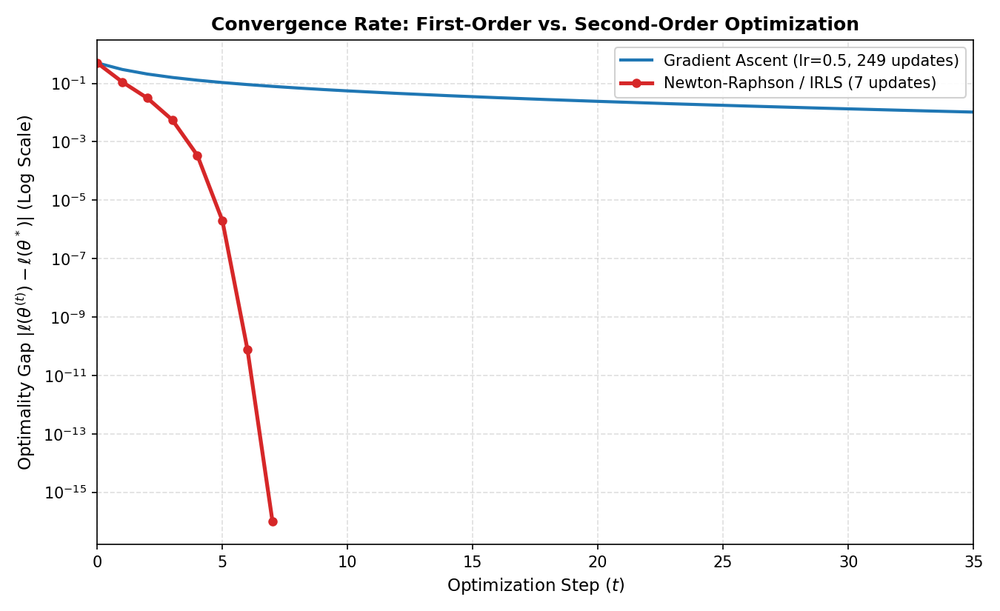

# Numerical Optimization & First-Principles Machine Learning

A pure NumPy implementation of foundational statistical learning algorithms and numerical optimization routines. This repository bridges blackboard theoretical derivations, specifically from **Stanford CS229**, with production-grade numerical stability. It avoids high-level machine learning frameworks (`scikit-learn`, `PyTorch`) to expose exact matrix calculus, curvature computations, and convergence behaviors.

---

## 1. Mathematical Formulations

### Ordinary Least Squares (OLS)

Given a design matrix $X \in \mathbb{R}^{n \times d}$ and target vector $y \in \mathbb{R}^n$, we augment $X$ with an intercept column to form $X_b = [\mathbf{1}, X] \in \mathbb{R}^{n \times (d+1)}$. The parameter vector is $\theta \in \mathbb{R}^{d+1}$.

#### Objective Function

The mean squared error (least mean squares) cost is defined as:

$$
J(\theta) = \frac{1}{2n} \lVert X_b\theta - y \rVert_2^2 = \frac{1}{2n} (X_b\theta - y)^T (X_b\theta - y)
$$

Expanding the quadratic form:

$$
J(\theta) = \frac{1}{2n} \left( \theta^T X_b^T X_b \theta - 2 y^T X_b \theta + y^T y \right)
$$

#### Analytical Solution (Normal Equations)

Taking the matrix derivative with respect to $\theta$:

$$
\nabla_\theta J(\theta) = \frac{1}{n} X_b^T (X_b\theta - y)
$$

Setting $\nabla_\theta J(\theta) = \mathbf{0}$ yields the normal equations:

$$
X_b^T X_b \theta = X_b^T y \implies \theta^{\star} = (X_b^T X_b)^{-1} X_b^T y
$$

> **Implementation note:** Rather than computing the explicit matrix inverse $(X_b^T X_b)^{-1}$, parameters are computed via `np.linalg.solve(X_b.T @ X_b, X_b.T @ y)`, which uses LU factorization to prevent floating-point precision degradation.

---

### Binary Logistic Regression

For binary classification targets $y^{(i)} \in \{0, 1\}$, the model parametrizes class probabilities via the sigmoid activation $\sigma(z) = \frac{1}{1 + e^{-z}}$:

$$
p^{(i)} = P(y^{(i)} = 1 \mid x^{(i)}; \theta) = \sigma\left((x_b^{(i)})^T \theta\right)
$$

#### Objective: Log-Likelihood Maximization

Under independent Bernoulli trials, the average log-likelihood is:

$$
\ell(\theta) = \frac{1}{n} \sum_{i=1}^n \left[ y^{(i)} \ln\left(p^{(i)}\right) + (1 - y^{(i)}) \ln\left(1 - p^{(i)}\right) \right]
$$

#### First-Order Gradient (Ascent Direction)

Using the identity $\sigma'(z) = \sigma(z)(1 - \sigma(z))$:

$$
\frac{\partial \ell(\theta)}{\partial \theta_j} = \frac{1}{n} \sum_{i=1}^n \left( y^{(i)} - p^{(i)} \right) (X_b)_{i, j}
$$

In vectorized form:

$$
\nabla_\theta \ell(\theta) = \frac{1}{n} X_b^T (y - p)
$$

Gradient ascent updates parameters along the positive slope:

$$
\theta^{(t+1)} = \theta^{(t)} + \alpha \nabla_\theta \ell(\theta^{(t)})
$$

#### Second-Order Curvature: Hessian Matrix

Differentiating the gradient $\nabla_\theta \ell(\theta)$ with respect to $\theta_k$:

$$
H_{jk} = \frac{\partial^2 \ell(\theta)}{\partial \theta_j \, \partial \theta_k} = -\frac{1}{n} \sum_{i=1}^n (X_b)_{i, j} \, p^{(i)}(1 - p^{(i)}) \, (X_b)_{i, k}
$$

Defining the diagonal weight matrix $W \in \mathbb{R}^{n \times n}$ with $W_{ii} = p^{(i)}(1 - p^{(i)})$, the full Hessian is:

$$
H = -\frac{1}{n} X_b^T W X_b
$$

Because $W_{ii} \ge 0$ for all $i$, $H$ is **negative semi-definite**, written $H \preceq 0$.

#### Newton-Raphson Parameter Update

Applying Newton's method to the stationarity condition $\nabla_\theta \ell(\theta) = \mathbf{0}$ gives:

$$
\theta^{(t+1)} = \theta^{(t)} - H^{-1} \nabla_\theta \ell(\theta^{(t)})
$$

---

## 2. Numerical Stability Engineering

Translating these equations directly into floating-point code causes numerical problems. This implementation uses four safeguards:

1. **Sigmoid domain clamping.** For $z < -709$, evaluating $e^{-z}$ overflows IEEE 754 floating point to `inf`. Logits are clipped first:

```python
   z_safe = np.clip(z, -500.0, 500.0)
   p = 1.0 / (1.0 + np.exp(-z_safe))
```

2. **Log-loss guardrails.** Evaluating $\ln(0)$ gives $-\infty$ and propagates `NaN`. Probabilities are clipped before taking logarithms:

```python
   p_safe = np.clip(p, 1e-15, 1.0 - 1e-15)
```

3. **$O(nd)$ Hessian assembly.** Forming $W = \mathrm{diag}(w)$ as an $n \times n$ matrix costs $O(n^2)$ memory, roughly 80 GB for $n = 100{,}000$. Broadcasting scales the rows directly instead:

```python
   w = (p * (1.0 - p)).reshape(n, 1)              # Shape (n, 1)
   H = -(1.0 / n) * (X_b.T @ (w * X_b))           # Shape (d+1, d+1)
```

4. **Tikhonov curvature damping.** When predictions saturate ($p_i \to 0$ or $1$), $w_i \to 0$ and $H$ becomes nearly singular. Subtracting $\epsilon_{\text{reg}} = 10^{-8}$ times the identity makes $H$ negative definite with a non-zero determinant. The update then subtracts the damped Newton step:

```python
   H_reg = H - eps_reg * np.eye(d + 1)
   delta = np.linalg.solve(H_reg, grad)
   theta = theta - delta
```

---

## 3. Asymptotic Complexity Analysis

| Algorithm | Order | Per-iteration time | Memory | Convergence rate |
| :--- | :--- | :--- | :--- | :--- |
| OLS (normal equations) | Analytical | O(nd^2 + d^3), single solve | O(d^2) | Exact (closed form) |
| Gradient ascent | First-order | O(nd) | O(d) | Linear |
| Newton-Raphson / IRLS | Second-order | O(nd^2 + d^3) | O(d^2) | Quadratic |

The convergence rates are:

* **Gradient ascent (linear):** $\lVert \theta^{(t)} - \theta^{\star} \rVert \le c^t \, \lVert \theta^{(0)} - \theta^{\star} \rVert$, with $0 < c < 1$.
* **Newton-Raphson (quadratic):** $\lVert \theta^{(t+1)} - \theta^{\star} \rVert \le M \, \lVert \theta^{(t)} - \theta^{\star} \rVert^2$.

### Trade-off Regimes

* **$d \ll n$ (few features, many samples):** Newton-Raphson is the better choice. The $O(d^3)$ solve is small next to the $O(nd)$ passes over the data, and the method reaches machine precision in 6 to 8 iterations, where gradient ascent needs thousands.
* **$d \gg n$ (high-dimensional):** First-order methods are the practical choice. Forming and factoring a $d \times d$ matrix becomes prohibitive when $d > 10^4$.

---

## 4. Empirical Convergence Benchmark

The benchmark compares first-order gradient ascent with second-order Newton-Raphson on synthetic Gaussian clusters.

### Experimental Setup

* **Dataset:** Bivariate binary classification with $n = 300$ and $d = 2$. A bias term gives $d + 1 = 3$ parameters.
* **Clusters:** $n_0 = n_1 = 150$, $\mu_0 = (-1, -1)^T$, $\mu_1 = (+1, +1)^T$, $\Sigma = I_2$ (so $\sigma = 1.0$), seed 42.
* **First-order baseline:** Gradient ascent with learning rate $\alpha = 0.5$, run for 250 updates.
* **Second-order method:** Newton-Raphson / IRLS with Tikhonov damping $\epsilon_{\text{reg}} = 10^{-8}$ and stopping tolerance $\lVert \Delta\theta \rVert_2 < 10^{-8}$.
* **Optimality gap:** $\left|\ell(\theta^{(t)}) - \ell^{\star}\right|$, where $\ell^{\star} = \ell(\theta^{(7)}) \approx -0.190684$ is the maximum log-likelihood reached at convergence. Exact zeros are clipped to $10^{-16}$ for the log-scale plot.



The horizontal axis is truncated at $t = 35$ to show the quadratic phase. Gradient ascent continues to $t = 250$.

### Interpretation

* **Gradient ascent (blue):** Converges linearly, with the gap shrinking by a roughly constant factor per step. It reaches 1.04e-2 at $t = 35$, first drops below $10^{-3}$ at update 98 (9.75e-4), and ends at 1.32e-5 after 249 updates.
* **Newton-Raphson (red):** Converges quadratically, so the number of correct digits roughly doubles at each update near the optimum.

| Update | Gap |
| :--- | :--- |
| 0 (initial) | 5.02e-1 |
| 1 | 1.12e-1 |
| 2 | 3.15e-2 |
| 3 | 5.61e-3 |
| 4 | 3.44e-4 |
| 5 | 1.99e-6 |
| 6 | 7.77e-11 |
| 7 | 0 (floating-point floor) |

---

## 5. Repository Structure

```text
numerical-optimization-ml/
├── README.md                 # Derivations and benchmark documentation
├── requirements.txt          # Dependencies (numpy, matplotlib)
├── benchmark.py              # Convergence experiment and plot generator
├── figures/
│   └── convergence.png       # Generated optimality gap plot
└── optimization/
    ├── __init__.py           # Public package exports
    ├── base.py               # Bias augmentation and line search routines
    ├── linear_model.py       # Closed-form and iterative OLS estimators
    └── logistic_model.py     # Gradient ascent and Newton-Raphson logistic solvers
```

---

## 6. Reproduction

Clone the repository and install the requirements:

```bash
git clone https://github.com/Mrad-MedAziz/numerical-optimization-ml.git
cd numerical-optimization-ml
pip install -r requirements.txt
```

Run the benchmark:

```bash
python benchmark.py
```
